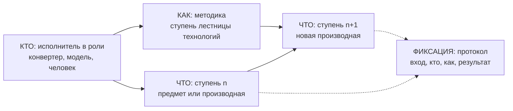
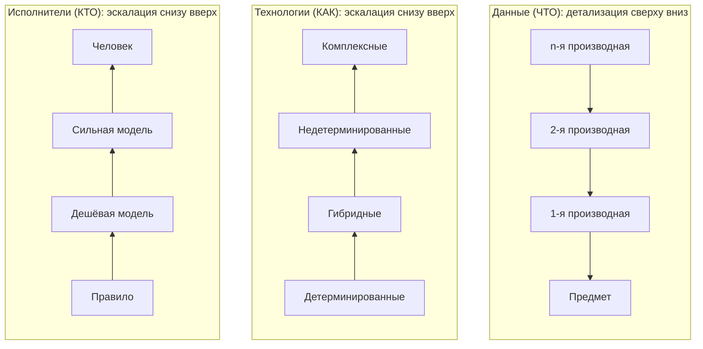

# Картотека доказательств: концепция

> И с отвращением читая жизнь мою,
> Я трепещу и проклинаю,
> И горько жалуюсь, и горько слезы лью,
> Но строк печальных не смываю.
>
> — А. С. Пушкин, «Воспоминание», 1828

Версия 0.8, 30.10.2026 (0.7 сокращена: основной текст коротко, подробности в приложении). Уровень: концепция.

## Цель
Собрать всё, что подтверждает профессиональный путь, и превратить это в знание для выводов, например под любую вакансию. Сначала полнота, оценка потом.

## Принципы
- **Только сверху.** Всё, что добавлено, не меняется. Любая обработка навешивается сверху: не удаляет и не перезаписывает ни исходное, ни чужие результаты. Обработки одного и того же конкурируют между собой, и выбирается лучшая; остальные остаются рядом.
- **Сначала дешёвое.** Где есть детерминированный способ, берём его; модель — только где он не справился; последнее слово — за человеком.
- **Фокус.** Одна узкая задача на один шаг.
- **Чувствительное не поднимается.** Документы личности, медицина, финансы, семья, третьи лица — только ссылкой, без содержания.

## Этапы
Сбор (всё, с дублями) → инвентаризация (факты о файлах) → выбор (первая оценка) → агрегат (карьерная история и профиль). Первые два — без оценки.

## Предмет и производная
Предмет — любой носитель знания о пути; он неизменен и собирается без оценки. Производная — закреплённое улучшение предыдущего уровня с допустимыми потерями; когда нужна точность, спускаемся к предмету.

## Лестницы
- Данные: предмет → 1-я производная → 2-я → …
- Технологии: детерминированные → гибридные → недетерминированные → комплексные.
- Исполнители: Правило → Низкий → Средний → Высокий уровень → Персона.

По данным спускаемся за точностью, по технологиям и исполнителям поднимаемся только при сбое. Любое изменение методики — новая методика.

## Уровни обработки
| № | Уровень | Вопрос |
|---|---|---|
| 1 | Носитель (item) | что есть и где лежит |
| 2 | Артефакт (artifact) | сколько разных вещей на самом деле |
| 3 | Содержание и мета | что внутри |
| 4 | Суть: аннотация | о чём это |
| 5 | Систематизация: организация, тип, дата | чьё, какого типа, когда |
| 6 | Категоризация | насколько ценно; про карьеру или нет |
| 7 | Контекст карьеры: роль, проект, период | к чему в карьере относится |
| 8 | Синтез: история, хронология, профиль, сеть, банк историй | что складывается |
| 9 | Применение: CV, письма, пакеты | что показать, кому и зачем |
| 10 | Отклик: ответы, интервью, отказы | что сработало |

Уровни 1–4 машинные, 5–7 смешанные, 8–10 — решения субъекта. У каждой производной: методика, дата, итог (Вынуто / Пусто / Ошибка); выбрана одна, остальные хранятся.

## Поток данных
Источники → холодный архив → хранилище на VPS по хешу (зашифровано) → база на VPS (опись и производные) → рабочий слой с вердиктами субъекта. База — источник истины; хранилище без базы ничего не говорит.

## Схемы базы
- `archive` — библиотека: всё учтено, ничего не потеряно, пополняется редко.
- `dict` — справочники, общие для архива и карьеры.
- `career` — рабочая выжимка (записи о карьере) со ссылками на артефакты-доказательства; появится позже.

## Стандарты и имена
Термины берём у архивного и библиотечного дела (OAIS, PREMIS, IFLA LRM, Dublin Core, ISAD(G)), своё вводим, только где стандарт молчит. Имена в базе: одно слово — сущность, два — связка, справочник — в схеме `dict` (без приставки), ссылка — `<сущность>_id`.

## Продукты, кроме карьерной истории
- **Сеть контактов** — кто, когда и в какой роли был связан с субъектом; хранится только ссылка, без персональных данных.
- **Обратная связь** — отзывы и отказы, положительные наравне с отрицательными; из повторов — карта роста.
- **Банк историй** — ситуация, задача, действие, результат, урок, с обязательными ссылками на доказательства.

## Открыто
- Какие уровни производных после содержания и в каком порядке.
- Категории шума ставятся правилами до аннотации, хотя по таблице категоризация — уровень 6: уточнить порядок.
- Срок хранения кандидатов и протоколов.

---

# Приложение: подробности

## П1. Этапы
1. Сбор — без оценки. Берётся всё, с дублями. Результат — холодный архив.
2. Инвентаризация — без оценки. Только факты о каждом файле: где лежит, что это, размер, дата, источник, хеш, сколько копий. Результат — опись.
3. Выбор — первая оценка. Из описи отбирается нужное, без дублей; закрытая зона не выбирается. Результат — горячий архив.
4. Агрегат — сборка из горячего архива под карьерную историю и профиль.

Соответствие пункту 1.5 Положения: сбор — этап 1; представление — этапы 2 и далее итерации производных; интерпретация — этапы 3 и 4. Реализация описывается отдельно и может отличаться для каждого этапа.

## П2. Предмет
- Предмет доказательства: любой носитель знания о моём пути. Электронный файл, бумага, скан, письмо, статья по ссылке, статья в журнале, который можно купить, собственная память.
- Это инвентаризация доказательств, как в уголовном процессе. Предметы собираются все, без предварительной оценки.
- Предметы не конфликтуют между собой, даже если имеют разную природу и говорят о разном.
- Носители и типы предметов не ограничиваются.
- Предмет неизменен.
- Секретное может существовать только в памяти. В картотеке тогда фиксируется лишь факт существования предмета, без содержания. Ни в базу, ни на внешние носители оно не выносится.

## П3. Производная и итерации
- Производная — качественное улучшение информативности предыдущего уровня, закреплённое с допустимыми потерями.
- Модели ошибаются и деградируют, но мы продолжаем их использовать: они лишь читают. Ожидается средний рост качества данных, на которых делаются выводы. Если роста нет, производная не нужна.
- Производная закрепляется и хранится постоянно. Она фиксирует допустимый уровень качества и даёт смысл.
- Когда нужна точность, можно спуститься на любой уровень ниже, вплоть до самого предмета.
- Итерация 0: извлечение. Её можно использовать сразу: искать, читать, строить первые выводы.
- Каждая следующая итерация (очистка, смысл, категории и далее) закрепляет и усиливает знание, но не обязательна для пользы предыдущих.

## П4. Роли при рождении производной
- Создатель: делает кандидатов.
- Кандидат: предложенный вариант производной. Их может быть несколько.
- Сторож: проверяет кандидатов. Детерминированно, где можно; недетерминированно, где нужно.
- Арбитр: сравнивает кандидатов, выбирает и выносит вердикт. Сам не пишет.
- Компоновщик: собирает итог по вердикту. Сам не судит. Его результат снова проходит сторожа.
- Редактор: человек. Последнее слово.

## П5. Принципы подробно
- Фокус: одна узкая задача на один шаг. Большой контекст снижает качество, фокус повышает.
- Лестница эскалации: детерминированная проверка, затем дешёвая перекрёстная, затем сильная модель при расхождении, затем человек, если не решено. В итоге выбирается один вариант.
- Где есть проверенный детерминированный способ, используем его. Где его нет (сканы, смысл), используем кандидатов и сторожа, при необходимости более сильной моделью.
- Форма производной: сейчас Markdown, при необходимости JSON.
- Протоколы экспериментов храним. Оценки устаревают. Срок хранения определим позже, без усложнения.
- Другой инструмент — новая методика, её результат ложится рядом. Выбранная версия переключается по явному признаку (меньше «????», текст вместо пустоты, Markdown вместо простого текста). Код методики хранится архивом в её строке.

## П6. Группы и сущности
- ЧТО — данные: предмет, производные, категории (метаданные — тоже данные).
- КАК — способы преобразования: методики перехода со ступени на ступень.
- КТО — субъекты изменения: исполнители (конвертер, модель, человек) и их роли (создатель, сторож, арбитр, компоновщик, редактор). Роль определяет, зачем исполнитель участвует и как влияет на качество.
- ФИКСАЦИЯ — протокол: что было на входе, кто, в какой роли, по какой методике, что получилось. Кандидаты, заключения и вердикты — содержимое протокола; закреплённый итог — производная.
- Связь групп: КТО, действуя КАК, переводит ЧТО со ступени на ступень; ФИКСАЦИЯ это записывает.

Сущности (черновик, не согласовано; группы согласованы):
- ЧТО
  - Предмет — доказательство любой природы. Неизменен. Может входить в другой предмет (вложение в письмо, статья в журнале).
  - Производная — закреплённое знание о предмете на ступени лестницы данных. Основана на предыдущей производной. Методика получения здесь не определяется, она относится к группе КАК.
  - Категория — метаданные: элемент словаря (вид деятельности, организация, проект, технология, тип предмета и т. п.).
- КАК
  - Методика — правило перехода со ступени на ступень. Сама является ступенью лестницы технологий.
- КТО
  - Исполнитель — тот или то, что меняет данные: конвертер, модель, человек.
  - Роль — зачем исполнитель участвует: создатель, сторож, арбитр, компоновщик, редактор.
- ФИКСАЦИЯ
  - Протокол — запись одного перехода: вход, исполнитель, роль, методика, результат. Внутри протокола — кандидаты, заключения сторожа, вердикт арбитра; закреплённый итог — производная.
- Сквозные понятия
  - Лестница — упорядоченная последовательность ступеней внутри группы.
  - Ступень (уровень) — место на лестнице. Не отдельная сущность данных, а положение сущности на лестнице своей группы.

Открытые вопросы по сущностям:
- Кандидат, заключение и вердикт — самостоятельные сущности или только содержимое протокола?
- Письмо — предмет с вложениями-предметами или особая сущность?
- Зона чувствительности — категория или свойство предмета?
- Факты (организация, период, роль, технологии) — отдельная сущность или производная одной из ступеней?

## П7. Лестницы подробно
- Уровень — это ступень лестницы. Лестница — упорядоченная последовательность ступеней внутри группы или элемента.
- Лестница данных (ЧТО): предмет, 1-я производная, 2-я, 3-я и далее. Каждая следующая основывается на предыдущей. Чем выше, тем больше смысла и тем больше допустимые потери.
- Лестница технологий (КАК): детерминированные; гибридные (детерминированный метод вместе с недетерминированным); недетерминированные; комплексные (несколько недетерминированных методов, объединённых вместе).
  1. Детерминированные — код и софт: скрипт, утилита, библиотека. Повторяемы: тот же вход и та же версия дают тот же результат. Описываются средой, инструментом и версией.
  2. Гибридные — пара «скрипт + дешёвая модель» в любом порядке: модель извлекает, скрипт подчищает, или скрипт готовит, модель думает. Повторяемости нет и из коробки быть не может.
  3. Недетерминированные — только модели и агенты, всё, что не повторяется. Описываются моделью, силой и версией.
  4. Комплексные — конвейер из всего сразу: детерминированные и недетерминированные шаги, несколько моделей.
- Уровень 3 (содержание) на этом этапе получаем только ступенью 1. Ступени не смешиваем; что ступень 1 не взяла, остаётся с итогом «пусто» или «не поддерживается» до следующего прохода.
- Лестница эскалации (КТО): от дешёвого исполнителя к сильному, затем к человеку. Ступени: Правило; Низкий уровень; Средний уровень; Высокий уровень; Персона.
- Методика описывается одинаково для любого исполнителя: ступень технологий, ступень эскалации, платформа и её версия, инструмент и его версия (для своего кода — коммит), на какие форматы рассчитана, описание (для модели — с версией промпта). Изменилось любое из этого — это новая методика; старую не правим.
- Протокол не лестница: он записывает движение по всем трём.

Принципы движения:
- Лестницы зафиксированы. Путь не придумываем каждый раз: как птица летает, взмахивая крыльями, так и мы всегда движемся по одной и той же лестнице.
- Детализация: по данным идём сверху вниз, когда нужна точность, вплоть до предмета.
- Эскалация: по технологиям и исполнителям идём снизу вверх, только когда нижняя ступень не справилась.
- Каждый переход со ступени на ступень — место для валидации.
- Стартуем с самой выгодной ступени и двигаемся только по необходимости. Дорогое и рискованное не используется без причины.

## П8. Схемы

Связь групп: КТО, действуя КАК, переводит ЧТО со ступени на ступень; ФИКСАЦИЯ записывает каждый переход.



Три лестницы: по данным спускаемся сверху вниз за точностью; по технологиям и исполнителям поднимаемся снизу вверх только при сбое.



## П9. Поток данных подробно
```
Источники (Google, почта, облака)
      │ сбор, без оценки
      ▼
Raw data на VPS — хранилище предметов objects/<aa>/<хеш>    (каждый предмет один раз; на диске зашифрован)
      │ инвентаризация, без оценки
      ▼
База на VPS: сырой слой        (строка = исходный путь + источник + хеш + метаданные; самих данных нет)
      │ носители без дублей → производные (текст, разметка)
      ▼
База на VPS: горячий слой      (рабочая таблица: отобранное, с датой, организацией, типом, сутью,
      │                         ролями, проектами, вердиктами; правится субъектом)
      ▼ выгрузка по необходимости
vasili.holub.pro               (копия отобранного по организациям — на всякий случай и для отправки)
```
- Сырой слой только пополняется и всегда пересобирается из raw data.
- Хранилище на VPS разложено по хешу, а не по исходным путям: путь, имя и источник носителя живут только в базе (уровень 1), а файл хранится один раз как предмет (уровень 2). Так снимается предел длины имён после шифрования, дубли не занимают места, и по хранилищу ничего не понять без базы.
- Горячий слой — рабочая таблица, а не только представление: в нём вердикты и правки субъекта, которые нельзя пересобрать автоматически. Поэтому он — главный объект резервного копирования базы.
- Drive vasili.holub.pro не является источником истины; пока это резервное хранение горячего слоя и место, откуда удобно делиться файлами.

## П10. Уровни обработки подробно
| № | Уровень | Назначение | Вопрос |
|---|---|---|---|
| 1 | Файл носителя: ID носителя, расположение, хеш, название, тип носителя, дата добавления | наличие | что есть и где лежит |
| 2 | Артефакт: ID предмета | уникальность | сколько разных вещей на самом деле |
| 3 | Содержание: данные, вынутые как смогли, грязные | прочтение | что внутри |
| 4 | Суть: аннотация | поиск | о чём это |
| 5 | Систематизация: детерминированные атрибуты (организация, тип, дата) | связь | чьё, какого типа, когда |
| 6 | Категоризация: оценочные атрибуты | оценка | насколько ценно и сильно |
| 7 | Контекст карьеры: роль, проект, период, событие | место в карьере | к чему в карьере относится |
| 8 | Синтез: развёрнутая карьерная история, хронология, профиль, сеть, карта роста, банк историй | история | что из этого складывается |
| 9 | Применение: пакеты, CV, письма под цель | действие | что показать, кому и зачем |
| 10 | Отклик: ответы, интервью, отказы | обучение | что сработало; возвращается в оценку (уровень 6) |

- Носитель (уровень 1) всегда знает, откуда он: ссылка на справочник источников. Источник — уникальное сочетание трёх независимых справочников (тип, вендор, аккаунт) плюс способ, дата и полнота сбора. Вендор и аккаунт сочетаются только через связку «вендор — аккаунт».
- Артефакт (уровень 2) — только уникальность содержимого; откуда он, на этом уровне не важно: это видно через его носители.
- Синтез строится только на привязке к карьере (уровень 7): история без привязки к ролям, проектам и периодам не собирается.
- Уровни не пропускаются: документ не поднимается выше, пока не прошёл нижний уровень.
- У каждой производной фиксируются методика (ступень технологий, ступень эскалации, платформа, инструмент, версии), дата и итог (Вынуто, Пусто, Ошибка с видом ошибки); выбрана одна, остальные хранятся.
- Исходный извлечённый текст неизменен; очищенный ссылается на исходный; в артефакте хранится только указатель на выбранный текст.

## П11. Опора на стандарты
Картотека — электронный архив. Термины и устройство берём у библиотечного и архивного дела, свои вводим только там, где стандарт молчит. В концепции пишем по-русски, в базе — английское имя из стандарта.

**OAIS (ISO 14721) — устройство архива.** Функции:
| OAIS | По-русски | У нас |
|---|---|---|
| Ingest | Приём | сбор в холодный архив, хеш, опись, загрузка в базу и хранилище (досинхронизация) |
| Archival Storage | Хранение (хранитель) | хранилище предметов на VPS: objects/<хеш>, зашифровано на диске |
| Data Management | Управление данными | база на VPS: опись, справочники, производные |
| Access | Выдача | поиск по базе и выдача файла; просмотр в DBeaver |
| Preservation Planning | Планирование сохранности | полные сверки хешей, контроль форматов |
| Administration | Администрирование | роли, ключи, резервные копии |

Пакеты OAIS: SIP (пакет приёма) — выгрузка как пришла (Takeout, письма, файлы облаков); AIP (пакет хранения) — предмет по хешу + его записи в базе; DIP (пакет выдачи) — то, что отдаём: файл, пакет для рекрутера (уровень 9).

**PREMIS (Библиотека Конгресса) — сохранность и происхождение.** Object — что храним; Event — что с ним сделали, когда и с каким итогом (eventOutcome = наш итог); Agent — кто сделал: софт, человек, организация (= методика и исполнитель); Fixity — хеш (SHA-256).

**IFLA LRM / FRBR — лестница от экземпляра к смыслу.**
| LRM | По-русски | У нас |
|---|---|---|
| Item | Экземпляр | носитель (уровень 1) |
| Manifestation | Издание, воплощение | предмет / артефакт (уровень 2): одинаковые байты |
| Expression | Выражение | одинаковый текст в разной форме (PDF и Word одного резюме): отпечаток содержания (уровень 3) |
| Work | Произведение | смысл («резюме 2023» во всех видах): суть и выше (уровни 4+) |

**Dublin Core (ISO 15836) — описание.** Набор полей уровня 5: Title, Creator, Date, Type, Format, Subject, Description, Source, Relation, Language, Identifier, Coverage, Rights, Publisher, Contributor.

**Архивное дело (ISAD(G)) — происхождение и порядок работ.** Фонд = источник; принцип происхождения: документы разного происхождения не смешиваются. Порядок «опись → описание → экспертиза ценности» = наш «сбор и инвентаризация без оценки → описание → оценка (уровень 6)». Авторитетные файлы = справочники единого написания (вендоры, организации, люди).

**Своё (стандарт молчит):** лестница технологий, лестница эскалации, сторож, кандидат и вердикт.

**Имена в базе.** Правило: одно слово — сущность (уникальна сама по себе); два слова — связка; `dict_…` — справочник (слов сколько угодно; служебные тоже, без отдельной приставки); `inbox` — входящие, промежуточная таблица загрузки. Ссылка — `<сущность>_id`. Носитель — `item` (стандарт LRM; carrier путался с career); предмет — `artifact` (= Manifestation); методика — `method` (агент в смысле PREMIS; инструмент — текстом в самой методике, без отдельного справочника); событие обработки — `event` (когда появится).

## П12. Сеть контактов
Архив служит не только истории карьеры, но и восстановлению профессиональной сети: кто, когда, в какой роли и по какому поводу был связан с субъектом.

- Контакт — носитель: запись адресной книги, адрес в письме, строка справочника, связь в LinkedIn. Неизменен, лежит в холодном архиве.
- Персона — производная: ФИО, организация, где искать (ссылки на контакты и носители), а также роль и период связи с субъектом.
- В сети хранится только ссылка. Никаких иных персональных данных (телефоны, адреса, почта, даты рождения и т. п.) в персону не копируется: они остаются в холодном архиве и доступны только по ссылке.
- Связь — кем персона была для субъекта: руководитель, коллега, подчинённый, заказчик, партнёр, рекрутер; с периодом.
- Взаимодействие — письмо, документ, встреча, проект; всегда опирается на носитель.
- Склейка нескольких контактов в одну персону — решение: модель предлагает, вердикт утверждает.
- Сеть контактов относится к закрытой зоне: используется субъектом лично и третьим лицам не передаётся.

## П13. Чувствительные данные
- Чувствительные данные (документы личности, визы и пребывание, медицина, финансы, семья, контакты и резюме третьих лиц) существуют только в источниках и в холодном архиве.
- В сырые данные картотеки они попадают только ссылкой или указанием местонахождения, без самих данных: без содержимого, без извлечённого текста, без производных.
- Ссылка должна быть непрозрачной (идентификатор файла в источнике или хеш), чтобы сама запись ничего не раскрывала; читаемое имя и путь не хранятся.
- В горячий архив и агрегат чувствительные данные не поднимаются.

## П14. Обратная связь
- Обратная связь — всё, что о субъекте сказали другие: рекомендации, отзывы, характеристики, благодарности, награды, оценки, а также замечания, критика, взыскания, жалобы, отказы.
- Отрицательная обратная связь собирается наравне с положительной. Это ценный материал для улучшения своих качеств: что повторяется, над чем работать, какие случаи разобрать к интервью.
- Тональность (положительная, нейтральная, отрицательная) — свойство отзыва; отдельной папки для отрицательного нет.
- В пакеты для внешних адресатов обратная связь попадает только по выбору субъекта.
- Отказы работодателей — обратная связь рынка; ведутся отдельно по откликам (компания, отклик, ответ, интервью, итог).
- Карта роста — производная: повторяющиеся темы из отрицательной обратной связи и отказов, сведённые в план развития.

## П15. Банк историй
- История — производная для интервью: ситуация, задача, действие, результат, урок; с обязательными ссылками на носители-доказательства.
- Истории о неудачах и конфликтах ценны наравне с историями успеха: «где ошибся, что понял, что изменил» убеждает сильнее гладкого списка достижений.
- Субъект вспоминает ситуацию, исполнитель находит доказательства в архиве и заполняет форму, субъект утверждает (вердикт).

## П16. Хранение (ориентир 0.7)
- Картотека, скорее всего, в Postgres. Минимум полей, расширяем по мере надобности. Возможны отдельные таблицы или отдельная база для разных уровней.
- Задача — зафиксировать идею, а не усложнять.

## П17. Открыто (из 0.7)
- Словарь категорий: откуда берётся и кто его утверждает.
